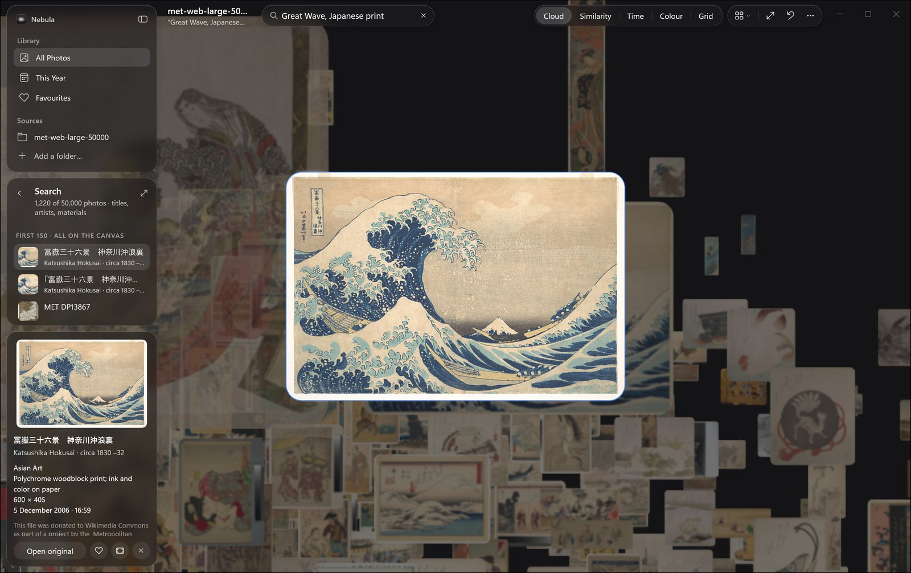
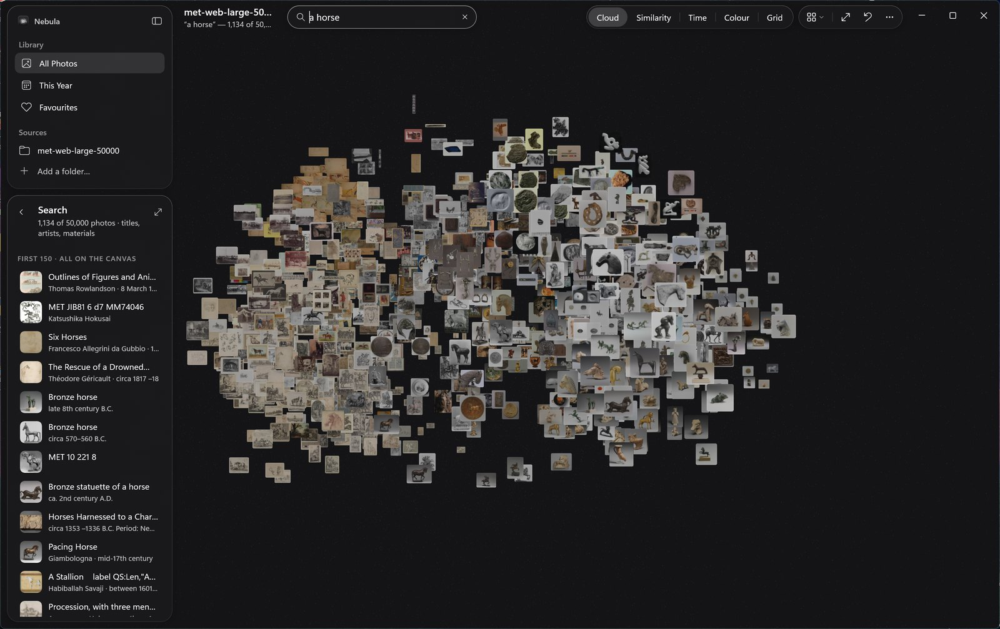
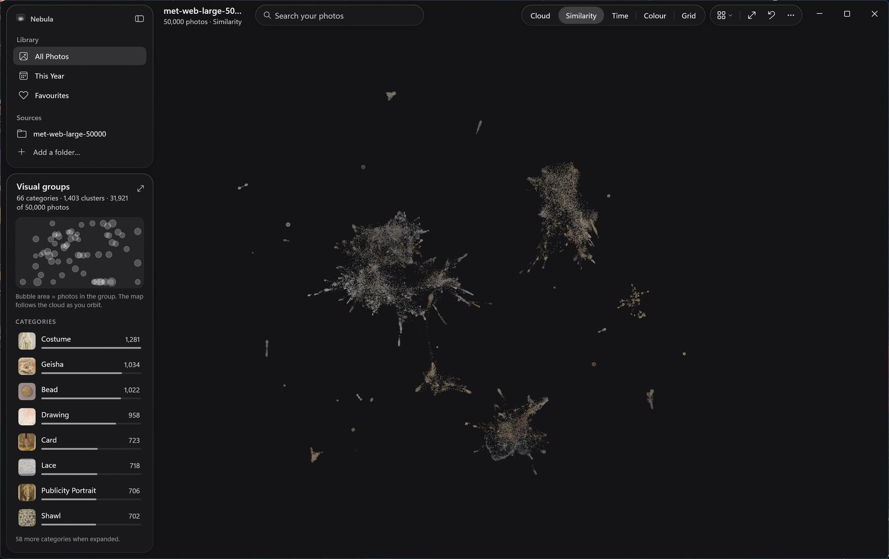
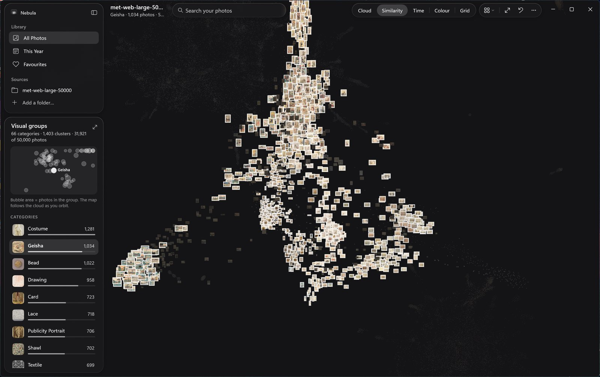

# Nebula

**Your whole photo collection in one 3D space.**

Point Nebula at a folder and every photo in it floats in a cloud you can orbit, zoom and fly through.
Fifty thousand photos fit on screen at once. Far away they are points of colour; as you move closer they
sharpen into photos; the one you pick opens at full resolution.

Type what you're looking for in plain words. "A horse" brings every horse forward, the drawings on one
side and the bronzes on the other. Switch to Similarity and the collection arranges itself by what each
photo shows, in groups Nebula names on its own.

It all runs on your PC. The AI model, the index and your searches stay local. Nothing is uploaded.



<sub>Searching "Great Wave, Japanese print" among 50,000 public-domain images from The Met.</sub>

## See it

**Search in plain words.** "A horse" finds 1,134 of 50,000 photos. Photos that look alike sit together,
and the best matches come forward.



**Similarity.** Every photo is placed by what it shows. Nebula finds 1,403 groups in this collection and
gathers them into 66 named categories. The map in the panel follows the camera as you orbit.



**Fly to a group.** Pick a category and the camera flies to it. Here, 1,034 Japanese woodblock prints.



## Features

- **The whole collection at once.** The renderer is tested at 100,000 photos. Distant photos are dots and
  colour mosaics; photos sharpen as you get closer; the photo you select loads at full resolution.
- **Five arrangements.** Cloud, Similarity, Time, Colour and Grid. Photos glide between them.
- **Search in plain words.** "A horse in the snow" finds horses in snow, not files named "horse". Without
  the AI model, search matches titles, artists and other metadata.
- **Visual groups.** In Similarity, photos that look alike form named groups and categories you can
  explore, pin and fly to.
- **Made for Windows input.** Two-finger touchpad scrolling orbits, pinch and Ctrl+wheel zoom, drag pans,
  and the main actions have keyboard shortcuts.
- **Frosted glass over live 3D.** The panels blur the photos behind them. Light and dark themes follow
  Windows; high contrast replaces the glass with solid system colours. Reduced motion is respected.
- **Private by design.** Nebula reads your originals and never modifies them. Thumbnails, embeddings and
  layouts are stored locally. Nothing is uploaded.

## How it's built

Nebula is a native Windows app.

| Part | Built with |
|---|---|
| Window, panels, search, menus, lists | [WinUI 3](https://learn.microsoft.com/windows/apps/winui/winui3/) XAML on the [Windows App SDK](https://learn.microsoft.com/windows/apps/windows-app-sdk/), packaged as MSIX |
| The 3D photo cloud and its frosted glass | A C++ Direct3D 11 renderer, drawing into a WinUI `SwapChainPanel` |
| Search, Similarity and visual groups | Google's [SigLIP 2](https://huggingface.co/google/siglip2-so400m-patch16-384) image model, run on the GPU by [Windows ML](https://learn.microsoft.com/windows/ai/new-windows-ml/overview) (ONNX Runtime with DirectML) |
| Layouts and clustering (PCA, PaCMAP, HDBSCAN) | C# on .NET 10 |
| Touchpad orbit | Windows Raw Input |

[docs/architecture.md](docs/architecture.md) explains how the pieces fit together.

## Requirements

- Windows 11 on an x64 or Arm64 PC with a DirectX 12 capable GPU (the AI model runs through DirectML).
- About 6 GB of free disk space for the optional AI model pack.

To build from source:

- [.NET 10 SDK](https://dotnet.microsoft.com/download)
- [Visual Studio 2026](https://visualstudio.microsoft.com/) with the **WinUI application development** and
  **Desktop development with C++** workloads, including the MSVC build tools for your PC's architecture
- [WinApp CLI](https://github.com/microsoft/winappCli) 0.7 or later, to deploy and launch the packaged app
  from the command line
- [Developer Mode](https://learn.microsoft.com/windows/apps/get-started/enable-your-device-for-development) turned on
- Python 3.12, only to prepare the AI model pack

## Quick start

```powershell
git clone https://github.com/lcoutodemos/Nebula
cd Nebula
.\build.ps1 -Run
```

Or open `Nebula.slnx` in Visual Studio, choose your platform (ARM64 or x64) and press F5. The first build
also compiles the C++ renderer.

After the first build, double-click `Launch Nebula.cmd` to start the app. It rebuilds only when the
sources changed. Click **Add a folder** to import photos.

### Turn on the AI features

Search in plain words, Similarity and visual groups need the SigLIP 2 model pack. Prepare it once:

```powershell
py -3.12 -m venv .venv
.venv\Scripts\python tools\prepare_models.py --install-deps --deps-only
.venv\Scripts\python tools\prepare_models.py
```

The script downloads SigLIP 2 from Hugging Face, converts it to ONNX, and writes the pack to
`%LOCALAPPDATA%\Nebula\Models`. The next time you open a collection, Nebula understands its photos in the
background. See [docs/local-ai.md](docs/local-ai.md).

## Documentation

| Document | Contents |
|---|---|
| [Building and running](docs/building.md) | Prerequisites, build scripts, Visual Studio, packaging, troubleshooting |
| [Architecture](docs/architecture.md) | How the projects fit together, threading, UI strings, and where data is stored |
| [Local AI](docs/local-ai.md) | The model pack, semantic search, Similarity and visual groups |
| [Renderer](docs/renderer.md) | The Direct3D 11 renderer, its C API, level of detail and glass |
| [Testing](docs/testing.md) | Core checks, GPU smoke tests, import validation and UI tests |

## Repository layout

```
src/
  Nebula.Windows/   WinUI 3 app (MSIX packaged)
  Nebula.Render/    C++ Direct3D 11 renderer (NebulaRender.dll)
  Nebula.Core/      Photo model, layouts, PaCMAP and HDBSCAN
  Nebula.Embed/     SigLIP 2 embeddings, semantic search and visual groups
tests/              Core algorithm checks and UI acceptance script
tools/              Model pack preparation, icon generator, embedding and import tools
models/vocab/       Word lists used to name visual groups
docs/               Documentation
```

## Contributing

Contributions are welcome. Read [CONTRIBUTING.md](CONTRIBUTING.md) first, and report security issues as
[SECURITY.md](SECURITY.md) describes.

## Credits

- The screenshots show images from [The Metropolitan Museum of Art Open Access](https://www.metmuseum.org/about-the-met/policies-and-documents/open-access)
  program, released under [CC0](https://creativecommons.org/publicdomain/zero/1.0/) through Wikimedia Commons.
  The repository contains these four screenshots and no other museum images.
- [SigLIP 2](https://huggingface.co/google/siglip2-so400m-patch16-384) by Google, Apache License 2.0.
- Group names draw on the [Recognize Anything](https://github.com/xinyu1205/recognize-anything) tag list and
  the [Places365](https://github.com/CSAILVision/places365) scene categories.
- BC7 texture compression by [bc7enc_rdo](https://github.com/richgel999/bc7enc_rdo).

## License

Nebula is licensed under the [Apache License 2.0](LICENSE). Third-party components and data are listed in
[THIRD-PARTY-NOTICES.md](THIRD-PARTY-NOTICES.md).
